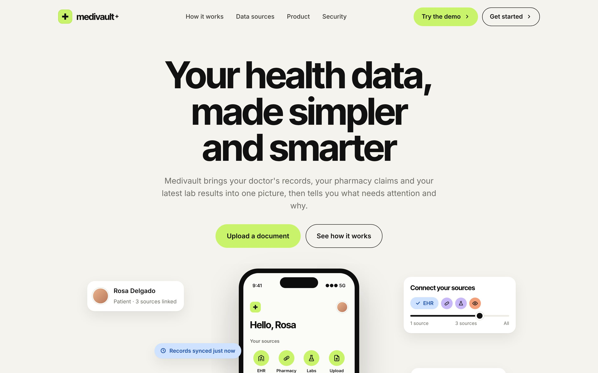
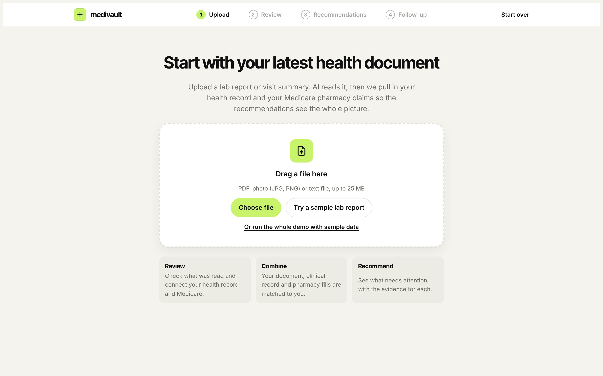
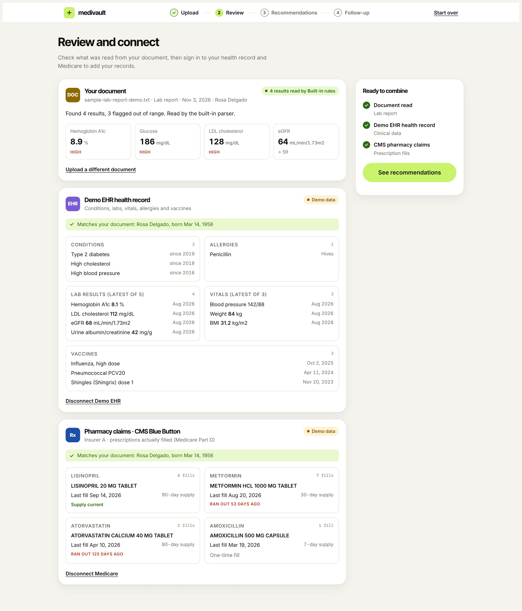
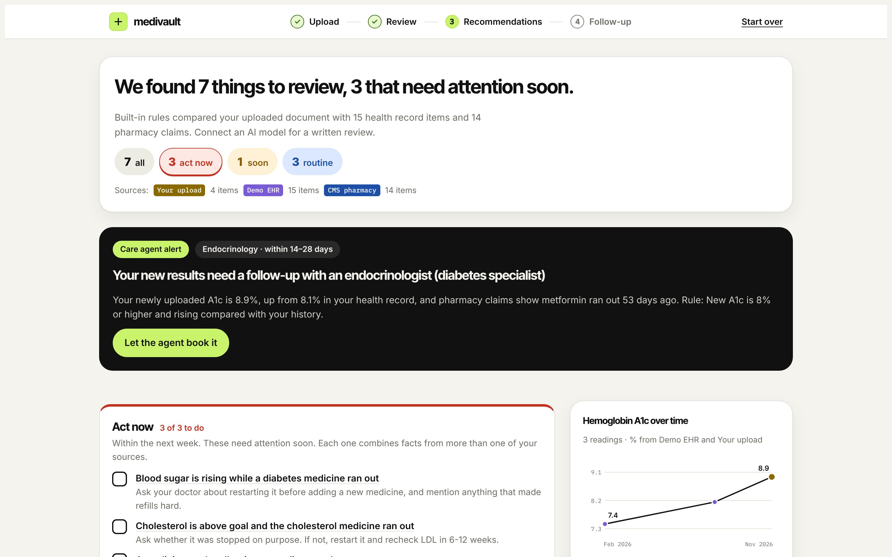
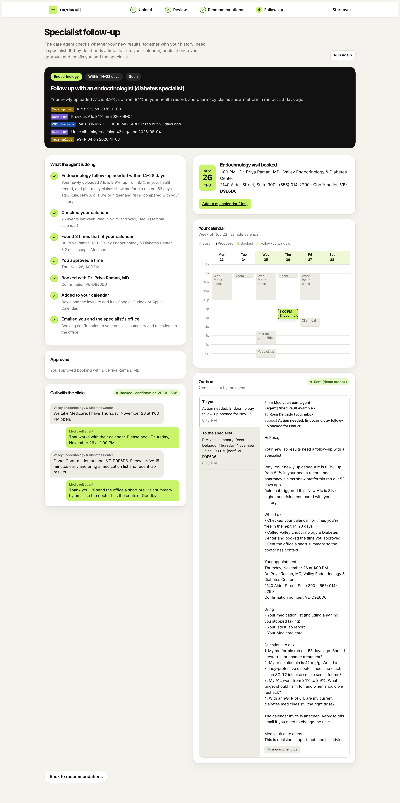
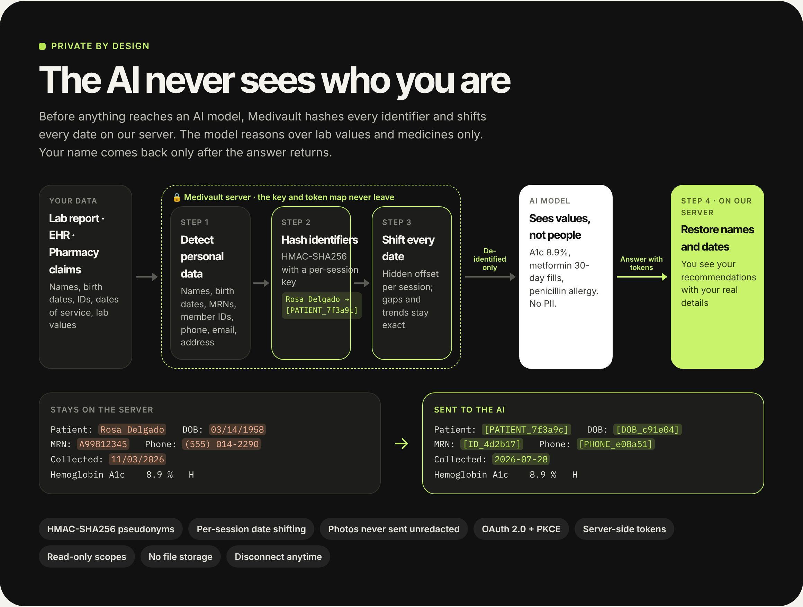

# Medivault

**Your health data, made simpler and smarter.** Medivault combines a patient's latest lab report, their EHR record and their insurer's pharmacy claims into one picture, explains what needs attention with evidence from each source, and has a care agent book a specialist follow-up when the new results call for one.



## Team

| | Name | Role |
|---|---|---|
| <a href="https://github.com/johntimothymaloney-cmd"></a> | [John](https://github.com/johntimothymaloney-cmd) | Business case |
| <a href="https://github.com/thetradingdoc"></a> | [Richard](https://github.com/thetradingdoc) | Solution architecture |
| <a href="https://github.com/sowmyapilla028-gif"></a> | [Sowmya](https://github.com/sowmyapilla028-gif) | Development |

## The problem

A patient's health story is split across systems that never talk to each other:

- **The doctor's EHR** knows diagnoses, lab history, allergies and vaccines, but not whether prescriptions were actually filled.
- **The insurer** knows every prescription that was picked up (and when it ran out), but not the lab results.
- **The newest lab report** often arrives as a PDF that sits in an inbox or a patient portal, outside both.

So the most important patterns are invisible to everyone: an A1c that keeps rising **because** the metformin refills stopped, an antibiotic dispensed to someone with a recorded penicillin allergy, a kidney marker creeping up while blood pressure pills are taken on time. Patients see three disconnected apps, and nobody turns the combined picture into a next step.

## The solution

Medivault walks the patient through four steps:

| Step | What happens |
|---|---|
| **1. Upload** | The patient uploads their latest lab report (PDF, photo or text). An AI model, or the built-in parser in demo mode, reads every value, flag and reference range. |
| **2. Review** | The patient checks what was read and signs in to their **EHR** (SMART on FHIR) and their **insurer** (CMS Blue Button pharmacy claims). Medivault matches all three sources to the same person by name and date of birth. |
| **3. Recommendations** | The server computes lab trends, refill gaps and safety conflicts across the sources, then produces prioritized recommendations. Clickable **Act now / Soon / Routine** tabs show a checklist of exactly what to do, by when, and the evidence behind each item. |
| **4. Follow-up agent** | If the new results, read with the patient's history, cross a referral rule (for example A1c 8%+ and rising), a care agent alerts the patient, checks their calendar, finds specialist times, and after the patient approves, calls the clinic, adds the visit to the calendar and emails the patient and the specialist. If no rule is crossed, it does nothing. |

### Screens

| | |
|---|---|
| **1. Upload**<br> | **2. Review and connect**<br> |
| **3. Recommendations with action tabs**<br> | **4. Follow-up agent: booked visit, call transcript, calendar and outbox**<br> |

The demo patient in the screenshots is fictional (demo data mode).

## Private by design

Nothing that identifies the patient is sent to an AI model. Every model call goes through `src/privacy.js` on the server:

1. **Detect** names, birth dates, record and member IDs, SSNs, phone numbers, emails and street addresses.
2. **Hash** each one with HMAC-SHA256 under a per-session key, e.g. `Rosa Delgado` → `[PATIENT_7f3a9c]`. The same value always gets the same token in a session, so the model can still tell records belong to one person.
3. **Shift every date** by a hidden per-session offset, so gaps and trends stay exact but real dates of service are not exposed.
4. **Restore** names and dates on the server when the answer comes back. The key and token map never leave the server.

Lab values, units, diagnoses and drug names are kept, because the model needs them to reason. Uploaded PDFs are read to text on the server and only the de-identified text is sent (never the file). Photos can't be de-identified, so they are refused when an AI model is configured, unless `PRIVACY_ALLOW_IMAGES=true`. The app shows a **"See exactly what the AI saw"** panel on the Review and Recommendations pages, and the tests fail if any name, birth date, ID, phone number or real date appears in a request to the model.



## Tools used

| Area | Tools |
|---|---|
| Backend | Node.js 20+, Express, express-session, Multer (uploads) |
| Health data standards | HL7 **FHIR R4**, **SMART on FHIR** (OAuth 2.0 authorization code + PKCE), US Core resources: Patient, Condition, Observation, AllergyIntolerance, Immunization; FHIR Slot and Appointment for scheduling |
| EHR source | **Epic** sandbox (fhir.epic.com) or the **SMART Health IT** sandbox (launch.smarthealthit.org) |
| Insurer source | **CMS Blue Button 2.0** sandbox: Part D prescription drug events (`ExplanationOfBenefit?type=pde`) |
| AI | Pluggable: any OpenAI-compatible Chat Completions API (**NEAR AI**, **OpenCode Zen**, OpenRouter, Ollama) or **Claude** via the Anthropic SDK; schema-validated JSON output with Zod |
| Documents | unpdf (PDF text extraction); built-in lab report parser for demo mode |
| Privacy | HMAC-SHA256 pseudonymization of identifiers, per-session date shifting, server-side re-identification |
| Agent | Server-Sent Events for live step streaming, human-approval gate before any action, iCalendar (`.ics`) invites |
| Frontend | Plain HTML, CSS and JavaScript (no framework); Inter and Inter Tight fonts; hand-built SVG charts |
| Testing | Node's built-in test runner with local mock servers for the EHR, CMS, Claude and OpenAI-compatible APIs (19 tests); Playwright for UI checks |
| Collaboration | GitHub, Claude Code |

## How it works

### The follow-up agent in detail

After the recommendations, a care agent checks whether a specialist visit is needed. It acts **only when the newly uploaded results, read with the patient's history, cross a referral rule**. Otherwise it reports "no follow-up needed" and does nothing else.

| Specialty | Trigger (from the uploaded document) | Book within |
|---|---|---|
| Endocrinology | A1c 10%+ | 3-14 days |
| | A1c 9%+ | 7-21 days |
| | A1c 8%+ and up 0.3+ from history, or 7.5%+ rising with a lapsed diabetes medicine | 14-28 days |
| Nephrology | eGFR under 30 / eGFR under 45 and down 10+ / urine albumin 300+ | 7-45 days |
| Cardiology (lipids) | LDL 190+ | 21-45 days |

These thresholds are demo rules in `src/agent/triage.js`, not clinical guidance.

When triggered, the agent streams each step to the page:
1. Alerts the patient with the specialty, the time window and the evidence (upload, EHR, pharmacy).
2. Checks the patient's calendar (a sample calendar in the demo) for that window.
3. Finds open specialist slots (simulated clinics, in FHIR `Slot` shape) that avoid busy times with a 45-minute travel buffer.
4. **Stops for approval.** Nothing is booked or sent until the patient picks a time.
5. Calls the clinic (simulated, with a live transcript; the agent identifies itself as an AI acting for the patient).
6. Creates the appointment (FHIR `Appointment`) and an `.ics` calendar invite.
7. Emails the patient (why, when, what to bring, questions) and the specialist's office (pre-visit summary with cited evidence and questions). Emails appear in the in-app outbox.

Endpoints: `GET /api/agent/triage`, `GET /api/agent/run` (Server-Sent Events), `GET /api/agent/book?slot=…` (SSE), `GET /api/agent/appointment.ics`. Set `PATIENT_EMAIL` to show a real address on the patient email.

### Architecture

```
browser ──upload──▶ /api/document ──PDF/image──▶ AI model (JSON) ──▶ results
browser ──connect─▶ /auth/{epic|cms}/start ──OAuth 2 + PKCE──▶ provider sign-in ──▶ /auth/{source}/callback
                                                     server fetches FHIR with the access token
browser ──────────▶ /api/recommendations: record + computed trends/refill gaps ──▶ AI model ──▶ recommendations
```

- Access tokens stay on the server (in the session); the browser only gets a session cookie.
- Epic endpoints are found with SMART discovery (`/.well-known/smart-configuration`); Epic gets the required `aud` parameter.
- CMS is a confidential client (client secret sent with HTTP Basic). Epic can be public (PKCE only) or confidential.
- The AI model is pluggable: any OpenAI-compatible Chat Completions API (OpenCode Zen, OpenRouter, Groq, a local Ollama) or Claude. Replies are validated against a schema and re-asked if they don't fit.
- PDFs are read to text on the server, so models without PDF support work. Photos need a vision model.

| Path | What it does |
|---|---|
| `src/server.js` | Express routes, sessions, upload handling |
| `src/oauth.js` | Authorization-code flow with PKCE, token exchange and refresh |
| `src/fhir.js` | FHIR read/search with Bundle paging |
| `src/sources/epic.js`, `src/sources/cms.js` | Fetch and normalize each source |
| `src/analysis.js` | Lab trends, medication supply and refill gaps, identity check |
| `src/llm.js` | AI model calls: document extraction and recommendations |
| `public/index.html` | The three-step UI |
| `test/` | Tests that run the full flow against local mock servers |

## Quick demo (no keys needed)

```bash
npm install
npm start
```

Open http://localhost:3000 for the landing page, then click **Try the demo** and **Or run the whole demo with sample data** (the app itself is at http://localhost:3000/app). With no AI model configured, Medivault reads documents with a built-in parser and writes recommendations with built-in rules, and the **Use demo data** buttons load a fictional patient's EHR record and pharmacy claims without signing in. Uploading your own text-based PDF also works in this mode.

### Presenter shortcuts

Each link resets the demo, loads the sample data and jumps straight to a step (also listed under "Presenter shortcuts" on the Upload page):

| Link | Shows |
|---|---|
| http://localhost:3000/app?demo=review | Review page with the sample report, demo EHR and pharmacy claims loaded |
| http://localhost:3000/app?demo=recommendations | Recommendations with the Act now / Soon / Routine tabs |
| http://localhost:3000/app?demo=followup | Follow-up agent when the new results **need** a specialist (A1c 8.9%, rising) |
| http://localhost:3000/app?demo=normal | Follow-up agent when the new results are **normal** (A1c 6.8%): it explains why and does nothing |

The Upload page also has two sample reports: **Results that need follow-up** and **Normal results**. Uploading a file with no lab results is rejected with a clear message.

## Setup

Requires Node.js 20 or newer.

```bash
npm install
cp .env.example .env
```

Then fill in `.env`:

### 1. AI model (optional: NEAR AI, OpenCode Zen or any OpenAI-compatible API)

Skip this to run in demo mode with the built-in parser and rules. For **NEAR AI** (the key you already use in OpenCode):

```
LLM_PROVIDER=openai
LLM_BASE_URL=https://cloud-api.near.ai/v1
LLM_API_KEY=your-near-ai-key
LLM_MODEL=a-model-id-from-your-near-ai-account
```

For **OpenCode Zen**:
1. Get an API key: sign in at https://opencode.ai, open Zen, add billing/credits, and create an API key. Put it in `LLM_API_KEY`.
2. List the models your key can use:
   ```bash
   curl https://opencode.ai/zen/v1/models -H "Authorization: Bearer YOUR_KEY"
   ```
   (In Windows PowerShell type `curl.exe` instead of `curl`.)
3. Pick a model that is served through `/chat/completions` (OpenCode's docs list which endpoint each model uses; GPT and Claude models on Zen use other endpoints) and put its ID in `LLM_MODEL`.
4. If that model can read images, set `LLM_VISION=true` so photo uploads work.

Other providers work the same way: set `LLM_BASE_URL` to their OpenAI-compatible base URL (for example `https://openrouter.ai/api/v1`, or `http://localhost:11434/v1` for Ollama, which needs no key). To use Claude instead, set `LLM_PROVIDER=anthropic` and `ANTHROPIC_API_KEY`.

### 2. EHR: nothing to do
With no EHR settings, Medivault uses the public **SMART Health IT sandbox** (https://launch.smarthealthit.org). It needs no registration and has synthetic patients. When you click Connect, it shows a demo login and a patient picker: pick any patient.

To use Epic later, register an app at https://fhir.epic.com (audience: Patients; redirect URI `http://localhost:3000/auth/epic/callback`; APIs: Patient.Read, Condition.Search (Problems), Observation.Search (Labs and Vitals), AllergyIntolerance.Search, Immunization.Search) and set `EPIC_CLIENT_ID`.

### 3. CMS Blue Button sandbox app
1. Sign up at https://sandbox.bluebutton.cms.gov and create an application.
2. Client type: **Confidential**, grant type: **Authorization code**.
3. Callback URL: `http://localhost:3000/auth/cms/callback`.
4. Copy the client ID and secret into `CMS_CLIENT_ID` and `CMS_CLIENT_SECRET`.
5. Sign in with a synthetic Medicare beneficiary (`BBUser#####` accounts, listed in the Blue Button docs).

### Run

```bash
npm start
```

Open http://localhost:3000. The server prints the exact redirect URIs it uses and warns about anything not configured.

### Test

```bash
npm test
```

The tests start local stand-ins for the EHR, CMS, Claude and an OpenAI-compatible API, and run the whole journey: upload, both OAuth flows (including PKCE and state checks), FHIR paging, refill-gap math and the recommendation request.

## Things to know

- **The sandboxes hold different people.** The EHR test patient, the Blue Button beneficiary and the person on your PDF are not the same person. Medivault compares name and date of birth, shows a warning on the Review page, and the AI model lists the mismatch under "Before you read these". A production build would link accounts to one verified user.
- **Sessions are in memory.** Restarting the server signs everyone out. Use a persistent session store (for example Redis) before deploying.
- **Not medical advice.** Recommendations are decision support for a demo.
- Uploaded files are never stored on disk. Only de-identified text is sent to your AI provider (see Private by design).
